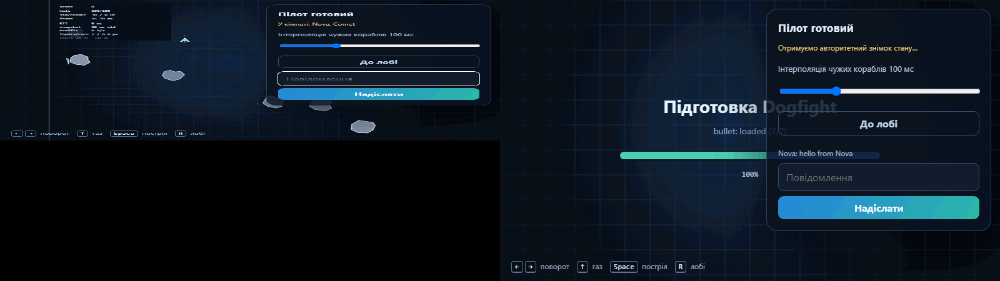
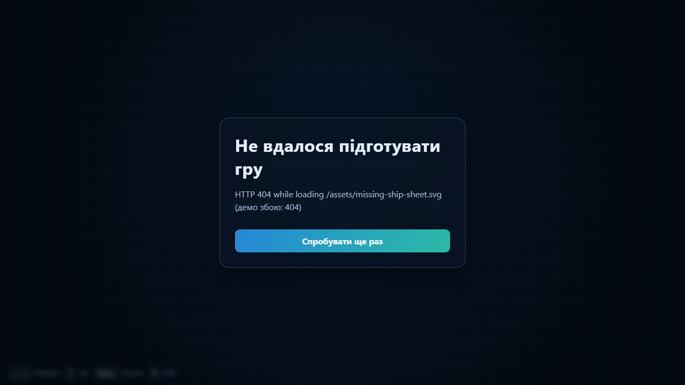
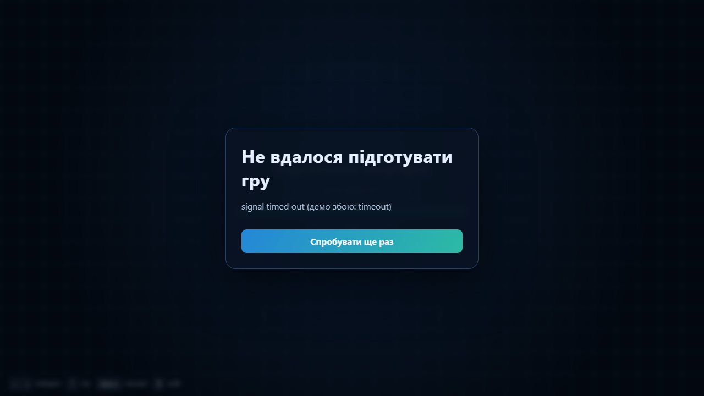
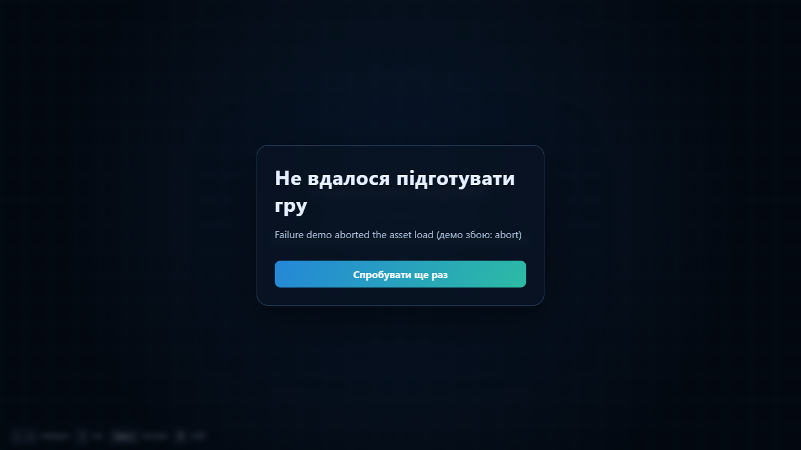
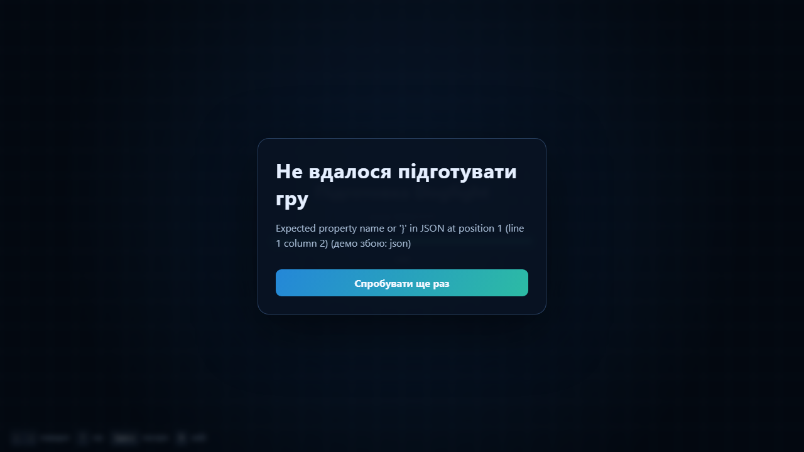
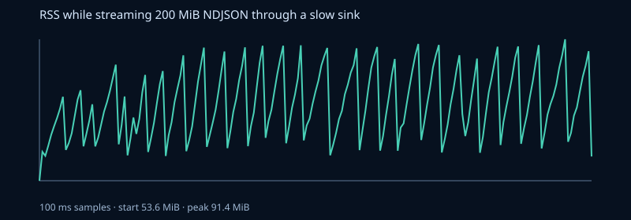

# Dogfight · JavaScript labs 1–8

Small real-time arena game used to study the browser event loop, async loading, object models, Node streams, authoritative multiplayer, TypeScript, testing, and deployment. The browser is only a renderer/input client; the Node process owns rooms and simulation state.

> Status: Labs 3–6 and the core Lab 7 test/load work are implemented. Local typecheck, lint, formatting, unit tests, and production build pass. Lab 7's browser Worker experiment did not show a responsiveness win, so the live game does not use it; a Chrome flame-chart and before/after browser profile remain outstanding. Lab 8's container, health/metrics endpoints, PWA shell, and release workflow are in place, but the local Docker daemon was unavailable for an image build. Public hosting is intentionally out of scope for this delivery; no live URL is claimed.



## Run it (Windows PowerShell)

The PowerShell execution-policy error for `npm.ps1` is avoided by invoking `npm.cmd` explicitly:

```powershell
npm.cmd install
npm.cmd run dev
```

Open <http://localhost:5173>. Click “Увійти до лобі” once to unlock Web Audio and load resources. Open a second browser window to join the same room and chat. Arrow keys turn/thrust, Space fires, R returns to the lobby. The canvas HUD shows frame/simulation rate, score/health, RTT, snapshot age, traffic, pending inputs, reconciliation correction, and interpolation delay.

Useful checks and demos:

```powershell
npm.cmd run typecheck
npm.cmd run lint
npm.cmd test
npm.cmd run build
npm.cmd exec playwright -- install chromium # once, for local E2E
npm.cmd run test:e2e
npm.cmd run start
```

`npm run dev` builds `shared/`, then starts the Node server on port 3000 and Vite on 5173. Vite proxies `/api` and `/ws`; its room-list route reads the static `client/public/api/rooms.json`, while the production Node server exposes the same room API. `npm run start` serves `client/dist` and APIs from one origin after a build. On PowerShell use `npm.cmd` for all of these commands.

Configuration is validated from the environment. Copy `.env.example` to `.env` if desired. `PORT`, `HOST`, `LOG_DIR`, `LOG_LEVEL`, origin allowlist, room/player/message caps, latency/jitter/drop injection, and JSON-vs-binary snapshot mode are validated before listening. For a JSON protocol comparison, set `$env:SNAPSHOT_FORMAT = "json"`; use `"binary"` to return to the default. The browser input codec can be switched with `?codec=json` (default is binary).

## Architecture

```text
client/  Vite canvas, lobby DOM, asset loader, audio, WebSocket/netcode
   │     JSON join/chat/ping + binary input; binary or JSON snapshots
   ▼
server/  node:http + ws, validated API/config, rooms, 30 Hz authority, logs/metrics
   │
shared/  deterministic seeded simulation, Zod protocol, DataView/JSON codecs
```

`shared/src/sim` has no DOM or Node imports. `WorldState` is plain data; the server and client call the same fixed-`dt` step. Randomness is state carried in snapshots, never `Math.random()` or wall-clock time inside simulation. The server accepts inputs (not client coordinates), steps rooms on absolute 30 Hz target times, and returns snapshots with each player's last processed input sequence. The local ship predicts immediately; after a snapshot, unacknowledged inputs are replayed and the position correction eases out over about 100 ms. Other ships are sampled between buffered snapshots in the past; the live interpolation slider defaults to 100 ms.

Binary protocol v1 is little-endian. Input frame: 12 bytes (`version:u8`, `type:u8`, `seq:u32`, `tick:u32`, `turn:i8`, flags `u8`). Snapshot: 28-byte header followed by 39-byte entity records. Angle is quantized in units of `1/10000` radian (maximum rounding error about `0.00005` rad); decoder validates version, exact length, known entity kinds, and finite coordinates. `shared/src/protocol/codec.ts` also retains the JSON codec for comparison.

The lobby (`Lobby extends EventTarget`) owns fetch, timeout, periodic refresh, and abort-on-leave; `lobby-view.ts` owns DOM. The game publishes `fired`, `hit`, and `exploded` simulation events through an `EventTarget` bus. `audio.ts` subscribes and plays already-decoded Web Audio buffers; simulation imports neither audio nor HUD. Room events use Node's typed `EventEmitter`; each room disappears from the live room map when its last player leaves.

## Lab 3 — async loading, lobby, and sound

`client/public/assets/manifest.json` lists sprites, sounds, and arena JSON. `loadImage`, `loadAudio`, and `loadJson` accept `AbortSignal`; JSON and images check HTTP `ok` (so a 404 is an `HttpError`); transient failures retry with exponential backoff plus jitter, while 4xx and aborts do not retry. `loadAll` runs independent assets with `Promise.all`, advances per-file progress, and the canvas shows the progress bar until `await loadAll(...)` succeeds. Missing optional sounds are recorded as nonfatal failures; a required asset error opens a Retry screen. Audio context creation happens on the player's click, and buffers decode during loading.

Run the local sequential-vs-concurrent measurement while the server is up: `npm.cmd run bench:assets`. It downloads every manifest resource once sequentially and once concurrently and writes [`reports/assets-timing.json`](reports/assets-timing.json). The relevant comparison is the measured elapsed time in that file; network/cache conditions affect the values, so do not treat a previous machine's result as a universal benchmark.

Local result for seven files / 31,933 bytes: sequential **19.53 ms**, concurrent **7.19 ms** (**2.72×** faster in this run). This is a localhost warm-cache measurement; compare the two modes on the same network when presenting it.

Failure gallery is repeatable in the Vite dev app: `/?failure=404`, `/?failure=timeout`, `/?failure=abort`, and `/?failure=json`. Each ends with a clear Retry button instead of a crashed game. The Playwright suite reproduces these four failures (HTTP 404 is asserted to be attempted exactly once) and saves screenshots under `reports/failures/`.

| 404 sprite (no retry)                                  | Network timeout                                                | Abort during load                                          | Invalid JSON                                                     |
| ------------------------------------------------------ | -------------------------------------------------------------- | ---------------------------------------------------------- | ---------------------------------------------------------------- |
|  |  |  |  |

Five ordering puzzles (each snippet is a separate console run):

1. `console.log("A"); Promise.resolve().then(() => console.log("B")); console.log("C");` → `A C B` — the current stack finishes before promise reactions run as microtasks.
2. `async function f() { console.log("1"); await 0; console.log("3"); } f(); console.log("2");` → `1 2 3` — even `await` of a non-promise suspends and resumes in a microtask.
3. `Promise.resolve().then(() => { console.log("A"); setTimeout(() => console.log("D"), 0); }).then(() => console.log("C")); Promise.resolve().then(() => console.log("B")); console.log("S");` → `S A B C D` — `.then` schedules microtasks; its timer is a later task.
4. `console.log("task 1"); requestAnimationFrame(() => console.log("frame")); Promise.resolve().then(() => console.log("micro")); console.log("task 2");` → `task 1, task 2, micro, frame` — the microtask checkpoint drains before the browser's next rendering opportunity.
5. `setTimeout(() => console.log("timer"), 0); Promise.resolve().then(() => console.log("micro")); console.log("sync");` → `sync, micro, timer` — timer delay is not a priority over promise reactions.

## Lab 4 — Node, rooms, streams, WebSockets

`server/src/index.ts` uses `node:http`, correct static MIME types, a traversal guard, `GET/POST /api/rooms`, `/health`, `/ready`, `/metrics`, and streamed replay downloads. `Room` is an `EventEmitter`, validates every join/chat/input, broadcasts roster/chat, applies a five-second join deadline, ping/pong every 15 s, a token bucket, `maxPayload`, per-IP/room/player caps, and a slow-client `bufferedAmount` policy. The browser socket wrapper has a bounded send queue and exponential reconnect delay. Shutdown stops room ticks, notifies and closes sockets, closes log pipelines, flushes pino, then exits 0 (with a nine-second hard deadline).

Each room event is transformed to NDJSON and piped to disk. Replay uses `createReadStream` + `pipeline`, and `readNdjson()` is an async generator. `GET /api/slow` intentionally blocks the event loop for 300 ms: while it runs, no other JS callback on that Node thread (including chat, timers, or HTTP callbacks) can run. Production errors are logged and exit nonzero; a bare `EventEmitter` `"error"` without a listener throws synchronously and can terminate the process. The room installs its listener, and the process has explicit fatal logging for uncaught exceptions and unhandled rejections.

Generate a slow-reader RSS graph with `npm.cmd run memory:demo` (optional `$env:LOG_MB = "200"` first). The script streams a synthetic NDJSON file through `createReadStream`/`pipeline` into a deliberately slow sink, sampling RSS every 100 ms; output is `reports/backpressure-rss.svg`, CSV, and JSON summary. This is a local stream/backpressure measurement, not a hosted 200 MB browser download.

Measured locally: **200 MiB** streamed in **20.61 s**; RSS started at **53.6 MiB** and peaked at **91.4 MiB** (+37.8 MiB), rather than growing to the full payload size. The graph and raw samples are committed alongside the summary.



## Lab 5 — authoritative multiplayer and binary protocol

Clients send tick-stamped, sequenced input only. The server applies it to the canonical world and returns state; no client coordinates are trusted. Snapshots acknowledge `lastProcessedSeq`; the client discards acknowledged inputs and replays the rest. The game has a seeded PRNG, a 30 Hz absolute-target room scheduler, editable 50–250 ms remote interpolation delay, and a network HUD for RTT, snapshot age, bytes/s, pending inputs, and correction magnitude. Set `NETWORK_LATENCY_MS`, `NETWORK_JITTER_MS`, and `NETWORK_DROP_RATE` to inject conditions at the server boundary without making the shared simulation nondeterministic.

`npm.cmd run bench:protocol` compares actual JSON and DataView byte sizes for the seeded arena sample and writes `reports/protocol-size.json`. In the local seven-entity sample, JSON was **1,678 bytes** and binary **301 bytes** (82.1% smaller). The online snapshots and inputs default to binary; setting `SNAPSHOT_FORMAT=json` and visiting `?codec=json` selects the comparison path. JSON remains useful for debugging; binary is smaller and fixed-width but requires the versioned schema and range checks.

| Sample                        |        JSON | Binary v1 | Reduction |
| ----------------------------- | ----------: | --------: | --------: |
| One ship + six arena entities | 1,678 bytes | 301 bytes |     82.1% |

Trade-offs: the server-authoritative model prevents clients from directly teleporting or setting score/health, but does not implement lag compensation or anti-cheat beyond validating input shape/rate. Prediction depends on identical deterministic simulation; seeded state is replicated, and RNG stays outside `Math.random()`. Remote interpolation hides jitter at the cost of rendering other pilots 100 ms in the past. No lag compensation means shots are judged in the server's current world, so high RTT can feel unfair.

## Lab 6 — TypeScript and runtime validation

The `client`, `server`, and `shared` packages compile under `strict`, `noUncheckedIndexedAccess`, `exactOptionalPropertyTypes`, and `useUnknownInCatchVariables`; `npm run typecheck` builds shared declarations first and checks all three. There is no `any`. There are four `as` assertions in implementation code: number-to-brand construction, the already-Zod-validated snapshot with branded IDs, and two casts for the worker global because the client TypeScript library is DOM-only. The worker casts have an adjacent explanation.

Types worth explaining at a defense:

- `EntityId`, `Tick`, and `Seq` are branded numbers: all are numbers at runtime, but TypeScript prevents accidentally passing a tick where a player/entity ID is expected.
- `EntityState` is a discriminated union: after checking `kind === "ship"`, TypeScript allows ship health fields and rejects bullet-only fields.
- `ClientMessage`/`ServerMessage` are inferred from Zod schemas. The type protects compiled code; `safeParse(unknown)` protects the actual network boundary at runtime.

What the migration caught: unchecked array/Map lookups in the lobby and snapshot interpolation needed explicit empty cases; WebSocket `RawData` can be a buffer or a buffer array rather than always having `byteLength`; DOM query results may be null; and the client/server codec boundary needed a real validated message type. The lobby and HUD stay in vanilla DOM because this app has one small screen and one canvas; a framework would add state/build concepts without replacing the hand-written fixed-step canvas loop.

## Lab 7 — tests and performance

`npm test` runs 80+ tests including five `fast-check` properties: vector laws, deterministic RNG range, binary input round-trip, snapshot record length, and client-message validation. Current local result: **86 tests passed; shared coverage 94.73% statements, 95.89% lines, 82.97% branches, 92.18% functions**. The coverage thresholds are enforced in `vitest.config.ts`.

`npm.cmd run perf` performs a deterministic 30 simulated seconds with eight bots and writes per-step p50/p95/p99 and RSS to `reports/performance.json`. This run measured p50 **0.020 ms**, p95 **0.066 ms**, p99 **0.240 ms**, max **0.651 ms** per step. `npm.cmd run loadtest` builds and starts an isolated server, then drives 8, 32, 64, and 128 scripted WebSocket bots (eight per room), sampling `/metrics`; the measured results are in [`reports/load-test.json`](reports/load-test.json):

| WebSocket clients | Rooms | Max tick p99 |       RSS | Step > 33 ms |
| ----------------: | ----: | -----------: | --------: | ------------ |
|                 8 |     1 |      1.12 ms |  74.7 MiB | No           |
|                32 |     4 |      0.59 ms |  79.2 MiB | No           |
|                64 |     8 |      0.60 ms |  80.8 MiB | No           |
|               128 |    16 |      0.41 ms | 100.4 MiB | No           |

The simulation reuses dead bullet/particle objects and scratch collision storage; per-tick ship movement is scalar math rather than allocating temporary vectors. These are repeatable Node simulation/load measurements, not Chrome's frame profiler results. This repository has post-optimization timings, but does not claim a before/after Chrome flame-chart comparison or browser GC/allocation profile.

The browser experiment at `/perf.html` runs the same 900-step/eight-bot workload on the page thread and in a Web Worker, measuring wall time and animation-frame gaps. In the latest headless Chromium run, main-thread wall time was **22.4 ms** with a **7.3 ms** max sampled frame gap; Worker wall time was **69.4 ms** with a **16.7 ms** max gap. The Worker therefore was not kept in the live game; see [`reports/browser-performance.json`](reports/browser-performance.json) and its [screen capture](reports/browser-performance.png). These numbers are one local run and not a device-independent claim.

CI (`.github/workflows/ci.yml`) checks types, lint, formatting, tests/coverage, production build, two-browser Playwright gameplay/chat, the Worker experiment, and four asset failure cases. [`reports/multiplayer.gif`](reports/multiplayer.gif) is an automated 20-second two-client capture. A Chrome DevTools flame-chart screenshot, before/after browser profiling, and real-phone test still require a manual browser profiling session; the offline 8-bot timing is not presented as a browser frame/GC profile.

## Lab 8 — container, readiness, metrics, release

`Dockerfile` uses a Node 24 Alpine multi-stage build, production-only dependencies, an unprivileged `node` user, a health check, and direct `node server/dist/index.js` startup so SIGTERM reaches Node. Release builds set `VERSION` to the tagged commit's Git SHA, which `/health` reports with uptime; `docker-compose.yml` is the local run. `/ready` returns 503 during shutdown, and `/metrics` reports players, rooms, message/byte rates, tick p99, event-loop utilization, RSS, rejected connections, and active sockets. WebSocket Origin is checked against the configured allowlist. Pino logs are structured and exclude chat content/secrets.

Tag pushes `lab-*` and `v*` publish GHCR images through `.github/workflows/release.yml`. This workflow does not deploy to a live host; public hosting and a live `wss://` address are intentionally not part of this delivery. To deploy later, add a separately reviewed deployment workflow, choose a Docker host/domain, configure its secret and the allowed production Origin, then verify `/health`, `/ready`, and `wss://` from a second network.

## Reflection prompts to rehearse

- Why is `await` non-blocking, and why do its continuations run before timers? Explain `Promise.all`'s fail-fast result versus cancellation.
- Why do stream `write()` calls signal backpressure, what does `pipeline` do with it, and why can a 300 ms Node handler stall every room on that process?
- Walk one input through prediction → server acknowledgement → pending-input replay. What breaks if the shared step uses `Math.random()`?
- Why is TypeScript not a network validator? Show where Zod turns `unknown` into a trusted message.
- What does the server gain by owning simulation, and what fairness problem remains without lag compensation?
- Which single measurement would tell you whether to optimize the simulation, renderer, network, or server tick next?

## Tags / remaining external work

This delivery publishes the milestones as `lab-03` through `lab-08` plus `v1.0.0` to `fipp1337/dogfight`. Public hosting is intentionally omitted by request. A Chrome DevTools flame-chart, before/after browser profile, and real-phone test remain manual evidence items; they are not claimed as completed here.
